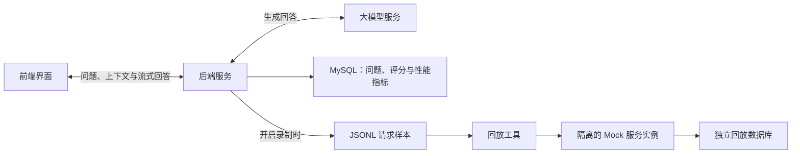

# AI Family Doctor

AI Family Doctor 是一个面向日常家庭健康问题的智能咨询助手。用户可以围绕身体不适、生活习惯和健康知识进行提问，并通过连续追问补充情况、理解回答，逐步梳理自己的疑惑。

项目希望帮助用户更容易地获取健康信息，了解日常自我照护中需要注意的事项，并为与医生沟通做好准备。它提供健康信息参考，不替代医生诊断或专业治疗。

## 核心功能

- **AI 对话**：用日常语言咨询健康问题，连续补充情况、追问细节，或要求解释专业术语、梳理回答重点。
- **实时回答与停止**：边生成边查看；发现问题需要调整时，可提前停止本轮生成，重新提问。
- **清空并重新咨询**：支持清空页面消息，开始新的咨询话题。
- **账号管理**：支持通过个人账号使用咨询服务。

> 对话上下文仅在当前页面保留，刷新后清空。回答用于健康信息参考，不替代专业诊疗。

## 项目架构

项目采用**前后端分离的模块化单体架构**，围绕健康咨询主流程，配套回答评估、请求录制和隔离回放能力。

| 模块 | 职责 |
|---|---|
| `family-doctor` | 提供登录和咨询界面，维护当前对话上下文，展示流式回答，支持停止及清空本地对话 |
| `ai-family-doctor-server` | 后端:负责身份验证、上下文校验与裁剪、模型封装与调用、流式推送、并发控制，以及问题和指标保存 |
| `medical-answer-scoring` | 模型回答内容测评:根据配置规则评估回答，输出各维度分数、规则命中情况和问题明细 |
| `ai-family-doctor-api-test` | 测试:提供接口测试与单条回放验证，检查流式协议和指标落库结果 |

## 问题记录与改进

| 问题 | 处理方式 |
|---|---|
| **持久 SSE 连接推送回答，需要维护连接池及断连清理** | 每轮提问创建独立 SSE 连接，通过 `delta`、`done`、`failed` 区分增量、完成和失败，结束后关闭连接 |
| **模型生成耗时较长，占用请求线程** | 使用独立异步线程池消费模型流，并设置队列容量、超时和拒绝处理 | 
| **多轮对话需要上下文，但历史会持续增长** | 客户端携带历史，服务端检查角色与顺序，按完整轮次和字符数截断 | 
| **同一用户重复提交，导致多次生成并行执行** | 使用用户级生成锁，并在完成、失败、超时和取消时释放 ,锁只在当前 JVM 生效，不能覆盖多个服务实例 |
| **回答完成、客户端断开和指标落库可能同时发生** | 统一管理请求终态，避免重复结束和重复统计，在发送终态事件前完成指标处理 | 
| **接口流量回放** | 将请求结构化录制为 JSONL，在独立数据库和 Mock 模型环境中回放，核对流式结果与指标 |
| **模型回答质量观测** | 保存问题全文、规则评分、请求状态和耗时指标，辅助比较不同请求的表现 (规则评分不能代表医学准确率) |

## 后续拓展
| 扩展方向 | 用户或项目可以获得什么 | 主要涉及模块 |
|---|---|---|
| **多会话与历史恢复** | 按不同健康话题分别咨询，刷新或重新登录后继续对话 | 前端会话列表、会话接口、会话与消息表 |
| **回答质量评估完善** | 更清楚地发现遗漏、风险提示不足和多轮回答不一致等问题 | 评测样本、评分模块、人工复核流程 |
| **健康知识来源展示** | 用户可以查看回答依据，进一步了解相关健康知识 | 知识检索、来源引用、前端展示 |
| **多实例部署** | 服务扩容后，仍能统一限制同一用户的并发生成 | 分布式并发控制、请求状态管理 |
| **运行监控与问题定位** | 更快定位请求失败、生成缓慢和录制积压的原因 | 指标监控、日志关联、告警 |